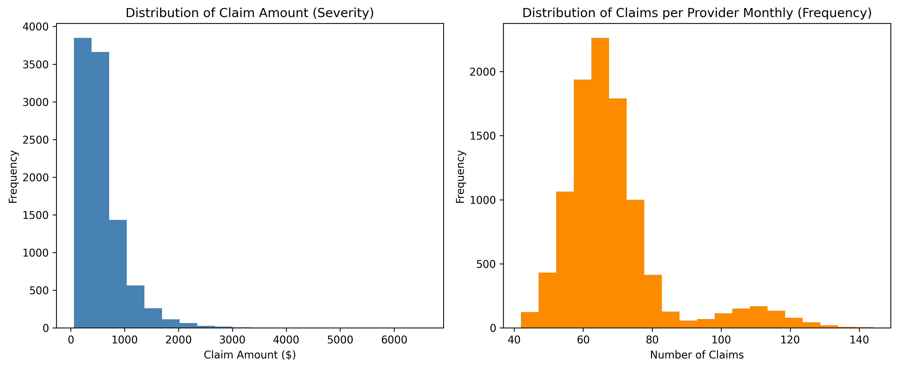
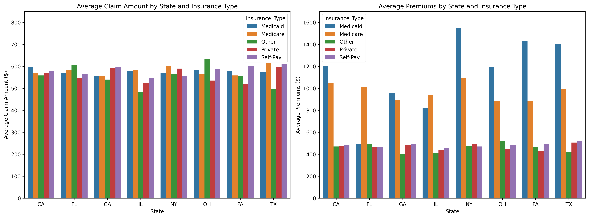

# Health Insurance Claim Severity and Frequency Analysis

This project explores the frequency and severity of health-insurance claims across U.S. states and insurance types. The analysis combines claim-level healthcare records with public premium and spending data to examine how claim amounts, claim volume, premiums, chronic conditions, fraud flags, and geography relate to one another.

The complete analysis is in [My_project_ML.ipynb](My_project_ML.ipynb).

## Project goals

- Compare claim severity (`Claim_Amount`) and claim frequency (monthly claims per provider).
- Explore differences by insurance type, patient age, chronic-condition status, fraud status, and state.
- Combine claims data with private, Medicare, and Medicaid premium/spending data to provide pricing context.
- Produce visualizations that can inform further predictive modeling and insurance-pricing analysis.

## Data sources

| Dataset | Purpose | Source |
| --- | --- | --- |
| `healthcare_fraud_detection.csv` | Claim-level healthcare and fraud data; includes claim amounts, provider activity, patient characteristics, insurance type, and state. | [Kaggle: Healthcare Fraud Detection Dataset](https://www.kaggle.com/datasets/nudratabbas/healthcare-fraud-detection-dataset) |
| `private_premiums.csv` | State-level Marketplace benchmark premiums. | [KFF Marketplace Average Monthly Benchmark Premiums](https://www.kff.org/state-indicator/?s=Marketplace+Average+Monthly+Benchmark+Premiums) |
| `medicare_premiums.csv` | Traditional Medicare enrollment and payments per enrollee by state. | [KFF Medicare spending per beneficiary](https://www.kff.org/medicare/state-indicator/per-beneficiary/) |
| `medicaid-premiums.csv` | Medicaid spending per full-benefit enrollee by state and eligibility group. | [KFF Medicaid spending per full-benefit enrollee](https://www.kff.org/medicaid/state-indicator/medicaid-spending-per-full-benefit-enrollee/) |

The notebook's healthcare dataset contains 10,000 claim records and 20 original columns. The premium datasets are state-level data and are merged with claims by state.

## Analysis workflow

1. Load the four CSV datasets.
2. Standardize state names to postal abbreviations and remove national aggregate rows.
3. Clean currency fields and convert Medicare and Medicaid annual figures to monthly values.
4. Merge the state-level private, Medicare, and Medicaid measures into the claim data.
5. Create a `Premiums` field based on insurance type and applicable age group.
6. Handle missing values by labeling missing provider specialties as `Unknown` and filling missing prior visits with `0`.
7. Explore claim frequency, claim severity, premiums, chronic conditions, fraud, and geographic patterns.

## Key variables

| Concept | Notebook field |
| --- | --- |
| Claim severity | `Claim_Amount` |
| Claim frequency | `No_of_Claims_Provider` (renamed from `Number_of_Claims_Per_Provider_Monthly`) |
| Premium/spending context | `Premiums` |
| Fraud indicator | `Is_Fraud` |
| Chronic-condition indicator | `Chronic_Condition_Flag` |
| Service-to-claim delay | `Service_Claim_days` |

## Outputs

The notebook saves visualizations for:

- Distributions of claim frequency and severity
- Claim amounts and premiums by insurance type
- Patient age versus claim amount
- Correlations among numeric claim variables
- Chronic conditions and prior visits
- Average claim amounts and premiums by state
- Claim frequency versus severity by insurance type
- Fraud status, fraud rate, and claim amount

Examples of generated figures:





## Run the notebook

Use Python 3.9+ and keep the four CSV files in the project root next to the notebook.

```bash
python -m venv .venv
source .venv/bin/activate  # Windows: .venv\\Scripts\\activate
pip install -r requirements.txt
jupyter notebook My_project_ML.ipynb
```

Run the cells from top to bottom. The charts are written as PNG files in the project root.

## Notes and limitations

- The analysis is exploratory; the notebook does not train or evaluate a machine-learning model.
- State-level premium and spending measures provide context and should not be interpreted as an individual member's exact premium.
- Medicare and Medicaid source definitions, reporting periods, and data-quality caveats differ; comparisons should be interpreted carefully.
- The private benchmark premium is directly applied only to 40-year-old private-insurance records. Other private, self-pay, and `Other` records use the notebook's `Approved_Amount` logic.
